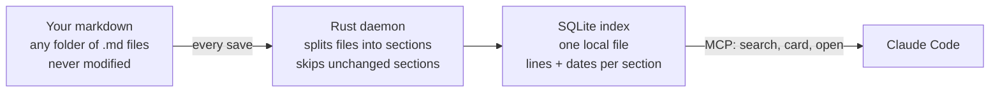
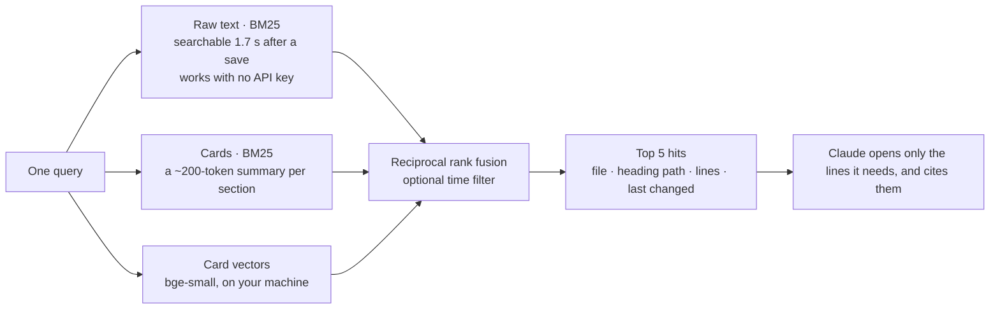

<p align="center">
  
</p>

<h2 align="center">Edit the runbook. Ask Claude what changed.</h2>

<p align="center"><b>markdownattractor gives Claude Code a live index of your markdown. Saved text is searchable in 1.7 s, and every answer points to the file, the lines, and when that section last changed.</b></p>

<table>
<tr>
<td width="50%" valign="top">

### ⚡ Indexed as it's written

A Rust daemon watches your folder. Every markdown file, whether you, a teammate or **Claude itself** wrote it (docs, reports, plans, notes), is searchable about **2 seconds after it's saved**. You never run an indexer, and Claude finds today's report in the next session without being told where it is.

</td>
<td width="50%" valign="top">

### 🕒 Never lost in stale docs

Every section knows when it was created and last changed, from git history (or file times outside git). Claude sees those dates on every hit, can search just the last week (`--since 7d`), and can ask for a timeline of what changed. So it can tell the current runbook from last year's, and the new decision from the one it replaced, instead of mixing them.

</td>
</tr>
</table>

<p align="center">
  A Claude Code plugin that keeps a live, searchable index of the markdown in your project.<br>
  One Rust binary. Search works with no key; summaries use your own Anthropic API key, a free local model, or your Claude subscription. The index stays on your machine, no telemetry, never writes to your files.
</p>

<p align="center">
  <a href="https://github.com/joe-carr-data/markdownattractor/releases"></a>
  <a href="LICENSE"></a>
  
  
  <a href="docs/benchmarks.md"></a>
</p>

https://github.com/user-attachments/assets/4979c76f-49c3-4d24-8ca6-95a66738ce88

<p align="center"><sub>A real Claude Code session on the demo corpus: Claude answers with its source, a teammate edits the runbook, and seconds later Claude reports what changed. Nobody ran a reindex. <a href="docs/demo/README.md">How it was recorded.</a></sub></p>

### How it works, at a glance





### Measured

| | |
|---|---|
| **8 s** | install to first search hit, with no API key (7 to 21 s, one machine) |
| **1.7 s** | save to searchable (median of 20 edits); the summary card is ready in 8.4 s |
| **98 %** | right section in the top 5 over 60 golden questions (88 % with no model at all) |
| **100 %** | answers fully grounded on the golden set: every claim cites lines Claude opened (87.5 % before the answer contract) |
| **3.18×** | fewer source tokens read than a knowledge-graph tool (graphify), at the same answer quality (the answer-contract run: same questions, 3 runs each, graded 0–6, golden corpus) |
| **60 ms** | per hybrid search (mean over the golden questions) |
| **96 %+** | of extracted dates and names judged supported by two model auditors |
| **$0.31** | to summarise a 32-file docs folder with Haiku (222K tokens); an edit redoes one section |

Gates were named before the results, and only what passed is claimed. Method and every number: [benchmarks](docs/benchmarks.md).

### Without a key

```
acme-docs % mda search canary --raw
no hits for "canary"
acme-docs % echo '## Canary' >> runbooks/deploy.md
acme-docs % echo 'Every release goes to 5% of traffic first.' >> runbooks/deploy.md
acme-docs % mda search canary --raw
 1. runbooks/deploy.md › Deploy runbook › Canary   L18–19 · ~13 tok · just now · raw (pending)
    Every release goes to 5% of traffic first.
```

<p align="center"><sub>A real terminal session on the demo corpus with no key set (the hint line and the <code>mda open</code> line trimmed): a saved section is searchable a second or two later. <a href="docs/demo/README.md">How it was recorded.</a></sub></p>

---

## The problem

The pager goes off. You ask Claude how to roll back. It greps the repo, reads runbook after runbook, and gives you a confident command. Then comes the question that matters before you hit Enter: **where is that written, and when did someone last change it?** Now you're reading the runbook yourself.

And the pile grows every day: Claude writes plans, reports and notes in markdown, so last month's plan and today's sit side by side, and nothing tells it which one is current.

markdownattractor answers both: where it is written, and how recent it is, on every answer.

## What markdownattractor does

A background daemon watches your folder. Every markdown file is split into sections. Each section is summarized once into a short **card** by Haiku through your own API key, or by a local model, and everything lands in a local index. Claude searches the index, reads the cards, and opens only the lines it needs.

```
you save deploy.md
        │  raw text searchable in ~2 s, card ready in ~8 s
        ▼
  ┌──────────────────────────────────────────────────────────┐
  │  search hit     runbooks/deploy.md › Rollback  L11–13    │
  │                 updated 2 days ago                       │
  │  section card   summary, entities, dates, questions      │
  │  exact lines    mda_open → only the lines that matter    │
  └──────────────────────────────────────────────────────────┘
```

Every hit carries provenance: **which file, which section, which lines, and when the section last changed.** In a git repository, times come from history: a section's change time is when the last commit touching its lines was authored, for every file that is committed and unmodified. Uncommitted edits, untracked files and folders without git use file times, and each time says which source it came from.

## What a session looks like

A real headless Claude Code session on the fictional demo corpus in [`evals/golden/docs`](evals/golden/docs) (an excerpt: the tool calls are verbatim, the results and the answer lightly trimmed):

```
> How do we roll back a failed deploy, and how long does it take?

⏺ mda_search("roll back a failed deploy, how long does rollback take")
  1. runbooks/deploy.md › Deploy runbook › Rollback            L11–13
  2. runbooks/deploy.md › Deploy runbook › Release             L5–9
  3. adr/0002-blue-green-deploys.md › ADR 0002 › Decision      L10–12

⏺ mda_open("58c690e807a880d0#2")    ⏺ mda_open("58c690e807a880d0#1")

  To roll back, run `deployctl rollback --to <previous-sha>` (runbooks/deploy.md:11-13):
  - Within 30 minutes of the release the previous colour is still warm, so traffic
    flips back within 20 seconds.
  - After that, a rollback is a full release of the old sha: about six minutes.
  When to roll back: watch the error-rate panel for ten minutes; above 1% is a
  rollback (runbooks/deploy.md:9).
```

One search, two sections opened, every claim cited to a line range. Ask *"what changed in the runbooks this week?"* and `mda_timeline` lists it, grouped by day.

## Install

Inside Claude Code:

```
/plugin marketplace add joe-carr-data/markdownattractor
/plugin install markdownattractor@markdownattractor
```

Then start it in your project. No key and no account are needed for this step:

```
/mda start
```

The plugin downloads the binary for your platform from the GitHub release on the next session start and checks its checksum. `/mda start` indexes the folder, and search works at once on the raw text of every section, with file, line range and dates. On the 32-file demo corpus that alone finds the right section in the top five for 88% of 60 questions (`mda eval`).

Cards (the short summaries) are the upgrade: with them and the local embeddings the same measure is 98%, and Claude can pick sections from summaries without opening them. Cards need a model, so give it one and restart:

```
export ANTHROPIC_API_KEY=…      # before launching Claude Code; or use a local model
/mda restart
```

| Backend | What you need | Cost | Speed |
|---|---|---|---|
| none | nothing | $0 | raw-text search only, no cards |
| **api** (default) | an [Anthropic API key](https://console.anthropic.com/) | Haiku list price; the 117-section demo corpus cost $0.31 | about 1 section/s at 16 workers |
| **local** | `brew install llama.cpp` and one command ([guide](docs/guides/local-model.md)) | $0 | depends on your machine |
| **claude-cli** (opt-in) | your Claude plan, signed in to Claude Code ([below](#use-your-claude-subscription-instead)) | your plan's usage limits | 4 workers, up to 16 |

### Use your Claude subscription instead

Have a Claude Pro, Max or Ultra plan and no API key? Let your own Claude Code write the cards:

```
/mda backend claude-cli --i-accept-the-policy
/mda restart
```

mda runs your own signed-in `claude` for the summaries and never sees, stores or passes on your login. The summaries count against your plan's usage limits, which Anthropic sets for ordinary individual use and may enforce without notice; a large folder is a lot of summaries. It is opt-in for that reason. If `ANTHROPIC_API_KEY` is set when Claude Code starts, `claude` bills that key instead of your plan: unset it to use the subscription. Details and the terms as quoted: [ADR-0010](docs/adr/0010-claude-subscription-backend-documented.md).

## What it does differently

| | |
|---|---|
| **Time is a first-class dimension** | Git history or file times, dates written *inside* the text, and index time are kept apart, per section. Search with `--since 7d`, or ask for a timeline of what the index saw created, changed, renamed or deleted. |
| **Summaries, not just chunks** | Cards carry a summary, the questions a section answers, entities and grounded dates, so queries match what people ask. Raw section text is indexed underneath, so nothing a card omitted is lost. |
| **Fresh, section by section** | A watcher plus a hash per section means only the section you edited is re-summarized. No rebuild step. Line ranges are re-checked when Claude opens them, and a changed section is flagged as stale instead of quoted wrong. |

## Commands

Everything is `/mda …` inside Claude Code, or `mda …` in a terminal. Every command supports `--json`. The search tools are also exposed to Claude over MCP. Other MCP clients (Codex CLI, Gemini CLI, Claude Desktop, Cursor, opencode) can use the same server: [setup guide](docs/guides/mcp-clients.md).

| | |
|---|---|
| **Lifecycle** | `start` · `stop` · `restart` · `status` · `watch` · `pause` · `resume` · `doctor` |
| **Search** | `search <q> [--since 7d] [--until …] [--in path] [--raw]` · `open <id>` · `card <id>` · `timeline` · `recent` · `stale` · `explain <q>` |
| **Indexing** | `index [path]` · `rebuild --embeddings` · `parse <file>` |
| **Configure** | `backend` · `embeddings` · `nudge` |
| **Meta** | `cost` · `diagnostics` · `schema` · `eval` |

## How it works

```
Watcher ─► Parser ─► Section diff ─► Workers ─► Validator ─► Index
(notify)   (comrak)  (blake3 per     (Haiku or   (evidence   (SQLite: FTS5 over cards and raw
                      section)        local)      check)      text, local embeddings, time)
```

- **Daemon** (`mda start`, one per folder): FSEvents/inotify watcher, debounced, `.gitignore`-aware. Renames keep their history without a model call. Never writes anything outside `.markdownattractor/`.
- **Section diff**: a blake3 hash per section. Unchanged sections never go to the model.
- **Workers**: an adaptive pool against the Messages API or a local OpenAI-compatible server, with structured output and a JSON schema. Concurrency ramps up on success and halves on rate limits.
- **Validator**: every extracted date and entity must quote an evidence substring that exists in the section, or it is dropped. On the demo corpus it dropped 16 dates and 49 entities.
- **Index**: SQLite with FTS5 over cards and over raw section text, plus card embeddings from a small local ONNX model (`bge-small-en-v1.5`, 33 MB, downloaded once), fused with reciprocal rank fusion. An optional recency prior is off by default.
- **MCP**: `mda_search`, `mda_card`, `mda_open`, `mda_timeline`, `mda_recent`, `mda_stale`, `mda_status`, served by the same binary (`mda mcp`).

Full design: [`docs/project-plan.md`](docs/project-plan.md).

## Guarantees

- **Never writes into your source files.** Identity lives in SQLite; your markdown is read-only to us.
- **A local index.** No cloud, no hosted service, no telemetry. The only network calls are the summarization requests with your key (none on the local backend) and the one-time download of the embedding model.
- **Grounded metadata.** Every stored date and entity quotes text that exists in its section; anything without evidence is dropped.
- **Honest benchmarks.** Corpora, comparators and gates are named before results exist. Every published number is rendered by a script from committed artifacts, preceded by a freeze, and a claim is made only where its preregistered gate passed. The headline claims, as measured ([benchmarks](docs/benchmarks.md); generated by `scripts/eval/t6.sh readme-row`, checked by `make check`):

<!-- benchmark-row:start -->
| Headline claim | Status, as measured (gates passed only) |
|---|---|
| Fewer source tokens at answer parity (T2, DocsQA test split; T6, our corpora) | No comparator pair passed all three gates; no savings claimed. |
| Fresh within seconds (T4) | Prisma, 20 edits, one machine: raw-searchable p50 1.7 s; card-ready p50 8.4 s (nearest-rank p50, as disclosed on the page). |
| Time questions correct with less effort at equal evidence (T5) | No pair met the correctness-and-effort criterion. |
| Retrieval: match qmd full (T1) | Hybrid point estimates met or exceeded qmd full on all 4 projects; all paired intervals included zero. |
<!-- benchmark-row:end -->

The rows above are the T1–T6 runs. The later answer-contract run (2026-11-15, golden corpus, 16 questions × 3 runs) is the first in which pairs pass all three gates: against graphify, **3.18× fewer source tokens** at the same answer quality; against grep, +0.25 answer correctness ([benchmarks § The answer contract](docs/benchmarks.md)).

## How it compares

| | graphify | qmd | **markdownattractor** |
|---|---|---|---|
| Target | code, docs and media | markdown and docs | markdown |
| Freshness | `--update` rebuild | `update` command | live watcher, **per section** |
| Time model | — | — | **per-section change time from git, dates in the text, timeline** |
| Summaries | LLM concept graph | none | **LLM cards plus raw text** |
| Retrieval | graph traversal | BM25, vectors, rerank | BM25, vectors |
| Runtime | Python | Bun | **one Rust binary** |

All three are measured side by side, with grep, on the [benchmarks page](docs/benchmarks.md). Head to head on docs: [markdownattractor vs graphify](docs/compare/graphify.md). We don't compete on scope: a code index covers the code, markdownattractor covers the prose around it.

## Status

**Released** (the badge above shows the current version; [changelog](CHANGELOG.md)). The engine, daemon, hybrid search, git-aware times, MCP server, search-first skill and release pipeline are shipped. Six benchmark tables are published (T1–T6). **Next:** links between documents (`supersedes`, `relates_to`), so Claude is told outright which decision replaced which.

Progress lives in [`docs/STATUS.md`](docs/STATUS.md). Lessons learned in [`docs/aha.md`](docs/aha.md).

## Contributing

Early users wanted: if you run Claude Code on a repo with a lot of markdown (ADRs, runbooks, specs, notes), open an issue titled `early user` and say roughly how many files. You get a direct line; we get the feedback that shapes the next release.

Read [`CLAUDE.md`](CLAUDE.md) for the golden rules before opening a PR. Every PR touching `crates/` gets a second-model review; findings are triaged in `docs/reviews/`, never silently dropped.

## License

Apache-2.0.
